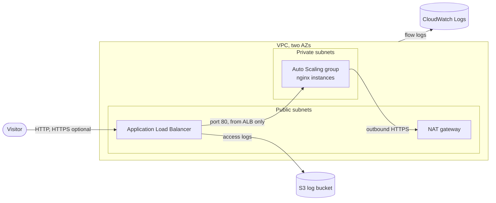

# AWS Web App on VMs

An nginx web app on an EC2 Auto Scaling group behind an Application Load Balancer.

OpenTofu demo template. Standalone, no dependency on other repos. Compatible with Terraform.

## Architecture



- VPC across two AZs: public subnets for the load balancer and NAT gateway, private subnets for the instances
- One NAT gateway for outbound traffic (not highly available, to keep cost low)
- Application Load Balancer with access logs to a private S3 bucket
- Launch template and Auto Scaling group (Amazon Linux 2023, nginx via `user-data.sh`), 2 to 4 instances
- VPC flow logs to CloudWatch Logs

## Security

- Instances in private subnets without public IPs. No SSH, access through SSM Session Manager
- IMDSv2 enforced, encrypted gp3 volumes, detailed monitoring
- Instances accept HTTP only from the load balancer security group, outbound HTTPS only
- Load balancer drops invalid header fields. Port 80 open to `advanced_settings.allowed_http_cidrs` (public by default)
- Optional HTTPS with an ACM certificate (`advanced_settings.certificate_arn`): HTTP then redirects to HTTPS, TLS policy `ELBSecurityPolicy-TLS13-1-2-2021-06`
- Access log bucket: public access blocked, SSE-S3, TLS-only bucket policy, logs expire after `advanced_settings.log_retention_days`
- Default security group without rules, VPC flow logs

Accepted checkov findings (documented inline in the code):

| Check | Reason |
|---|---|
| CKV2_AWS_28 | WAF is out of scope for the demo (cost) |
| CKV_AWS_150 | Deletion protection is configurable, off by default so the demo can be destroyed |
| CKV_AWS_260 | The web app is public on port 80; flagged on the instance rule as a false positive (source is the load balancer security group) |
| CKV_AWS_378 | TLS ends at the load balancer, traffic to the instances stays inside the VPC |
| CKV_AWS_2 | The listener redirects to HTTPS when a certificate is set. Without a certificate the demo serves plain HTTP on purpose |
| CKV_AWS_18, CKV_AWS_21, CKV_AWS_144, CKV_AWS_145, CKV2_AWS_62 | Log bucket: it is the log bucket itself, logs are written once, ALB supports only SSE-S3, no replication or events needed |
| CKV_AWS_338, CKV_AWS_158 | Flow log retention is configurable, AWS-managed encryption |
| CKV_AWS_394 | Only the first two zones are used |

The Trivy scan (`trivy config`) accepts findings with `#trivy:ignore` comments above the resource. The reason is written in the same line.

## Usage

Configure AWS credentials, for example with `aws configure sso` or environment variables.

```bash
cp terraform.tfvars.example terraform.tfvars
tofu init
tofu plan
tofu apply
```

## Access

Open the `url` output in a browser. Each instance shows its instance ID, so reloading shows the load balancing. Shell access to an instance:

```bash
aws ssm start-session --target <instance_id> --region <region>
```


## Inputs

| Name | Description | Default |
|---|---|---|
| `name_prefix` | Prefix for all resource names | `"demo"` |
| `region` | AWS region | `"eu-central-1"` |
| `instance_type` | EC2 instance type (x86_64) | `"t3.micro"` |
| `advanced_settings` | Object with the settings below, all optional | `{}` |

`advanced_settings` attributes (shown as "Advanced Settings" in the StackGuardian form):

| Name | Description | Default |
|---|---|---|
| `vpc_cidr` | CIDR block of the VPC | `"10.0.0.0/16"` |
| `min_size` | Minimum (and desired) number of instances | `2` |
| `max_size` | Maximum number of instances | `4` |
| `allowed_http_cidrs` | CIDRs allowed to reach the load balancer | `["0.0.0.0/0"]` |
| `certificate_arn` | Optional ACM certificate for HTTPS | `null` |
| `deletion_protection` | Protect the load balancer from deletion | `false` |
| `log_retention_days` | Retention of access and flow logs | `90` |
| `tags` | Additional tags for all resources | `{}` |

## Outputs

| Name | Description |
|---|---|
| `url` | URL of the web app |
| `load_balancer_dns_name` | DNS name of the load balancer, DNS target for a custom domain |
| `autoscaling_group_name` | Name of the Auto Scaling group |
| `access_logs_bucket` | S3 bucket with the access logs |

## Cost

The load balancer, the NAT gateway and the instances are billed hourly, also when idle. Apply waits until the instances are healthy behind the load balancer, which takes a few minutes.

**Destroy after the demo:**

```bash
tofu destroy
```

## Tests

The GitLab pipeline (`.gitlab-ci.yml`) lints every push. Merge requests into `development` or `main` also run
validation, the checkov and Trivy scans and the unit tests. A tag runs all of these plus the integration tests, which deploy
real resources and destroy them again, and then creates a release. Integration tests run only when the CI/CD variable `AWS_ROLE_ARN` is set: an IAM role trusted for GitLab OIDC with the audience `sts.amazonaws.com`. `AWS_REGION` is optional.

In GitLab, the `unit-tests` job also publishes its results as a JUnit test report, which you find in the **Tests** tab of the pipeline and of the merge request. The script `ci/tofu-json-to-junit.py` converts the output of `tofu test -json` to JUnit XML.

The GitHub Actions workflow (`.github/workflows/ci.yml`) runs the same jobs: every push, pull requests into `development` or `main`, and tags. Set `AWS_ROLE_ARN` (and optionally `AWS_REGION`) as repository variables; the IAM role then needs a trust for GitHub OIDC (`token.actions.githubusercontent.com`).

```bash
tofu test -test-directory=tests/unit
```

Test cases: [tests/README.md](tests/README.md)

## Development

```bash
pre-commit install
pre-commit run --all-files
```
